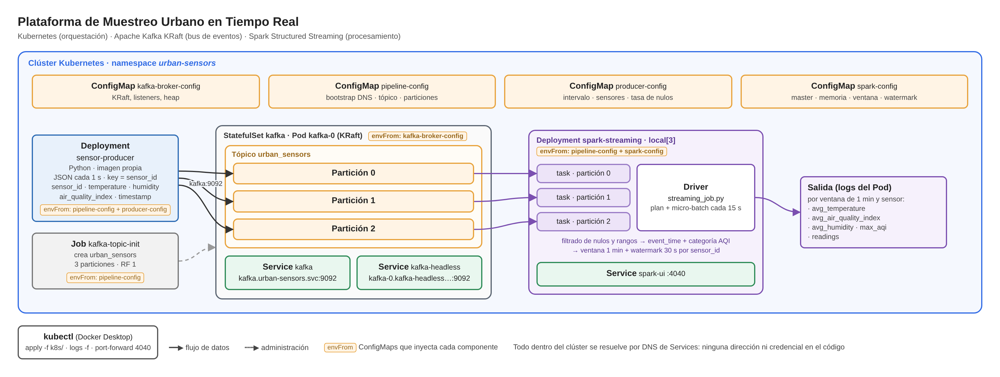
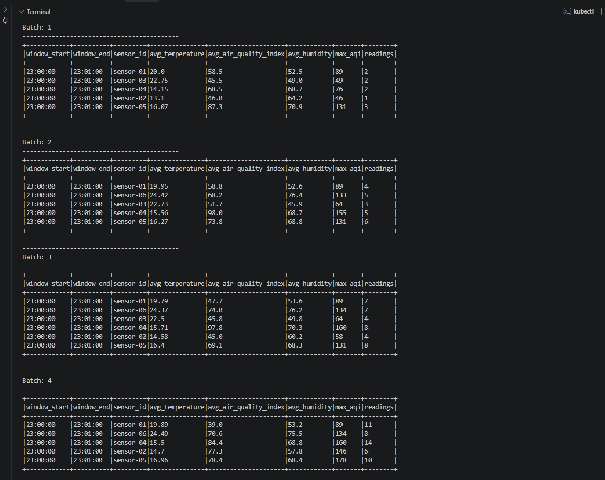
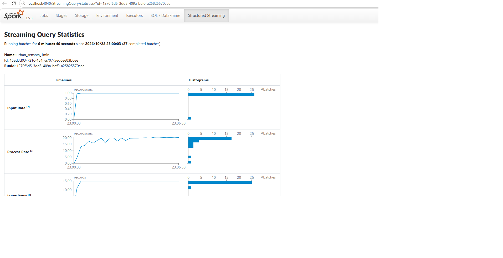

# Plataforma de Muestreo Urbano en Tiempo Real

Arquitectura de ingeniería de datos distribuida desplegada íntegramente en **Kubernetes**:

- **Producer (Python):** simula una red de sensores urbanos y publica lecturas JSON en el tópico `urban_sensors`.
- **Apache Kafka (modo KRaft):** bus de eventos con 3 particiones.
- **Spark Structured Streaming:** consume el tópico en tiempo real, filtra lecturas inválidas y calcula, en **ventanas de 1 minuto**, el **promedio de temperatura y de calidad del aire por `sensor_id`**.

Todos los componentes corren como Pods dentro del namespace `urban-sensors`, configurados con **ConfigMaps** y comunicados por el **DNS interno** de los Services.

## Arquitectura



**Flujo de datos:**

1. El **Job** `kafka-topic-init` espera a que el broker responda y crea `urban_sensors` con **3 particiones**, antes de que se escriba cualquier mensaje.
2. El **Deployment** `sensor-producer` publica una lectura por segundo con `sensor_id` como key. Kafka asigna la partición a partir de la key, así que las lecturas de cada sensor quedan ordenadas en una misma partición.
3. El **StatefulSet** `kafka` (Pod `kafka-0`) almacena los eventos. Los clientes se conectan por el Service `kafka` (bootstrap) y el broker les anuncia su DNS estable `kafka-0.kafka-headless...`.
4. El **Deployment** `spark-streaming` lee el tópico en micro-batches cada 15 s, con **una task por partición**. Filtra, proyecta y agrega por ventana de 1 minuto, y escribe el resultado en los logs del Pod.
5. Con `kubectl` se despliega todo, se leen los logs y se accede a la Spark UI con `port-forward`.

## Estructura del repositorio

```
.
├── k8s/                                  # todos los manifiestos (se aplican en orden por nombre)
│   ├── 00-namespace.yaml                 # namespace urban-sensors
│   ├── 01-configmap-kafka.yaml           # configuración del broker (KRaft, listeners, heap)
│   ├── 02-configmap-pipeline.yaml        # compartida: bootstrap DNS, tópico, particiones
│   ├── 03-configmap-producer.yaml        # simulación: intervalo, sensores, tasa de nulos
│   ├── 04-configmap-spark.yaml           # Spark: master, memoria, ventana, watermark, trigger
│   ├── 10-kafka-services.yaml            # Services kafka (bootstrap) y kafka-headless (DNS por Pod)
│   ├── 11-kafka-statefulset.yaml         # broker Kafka KRaft
│   ├── 12-kafka-topic-job.yaml           # Job que crea urban_sensors (3 particiones)
│   ├── 20-producer-deployment.yaml       # Deployment del producer
│   ├── 30-spark-deployment.yaml          # Deployment del job de Spark
│   └── 31-spark-service.yaml             # Service de la Spark UI
├── producer/
│   ├── producer.py                       # simulador de sensores urbanos
│   ├── requirements.txt
│   └── Dockerfile
├── spark/
│   ├── streaming_job.py                  # Spark Structured Streaming: filtrado, proyección, ventana
│   └── Dockerfile                        # Spark 3.5.3 + conector Kafka incluido
├── docs/                                 # diagrama y evidencias
└── README.md
```

## Componentes y decisiones de diseño

### Mensaje

```json
{
  "sensor_id": "sensor-03",
  "temperature": 21.4,
  "humidity": 63.0,
  "air_quality_index": 48,
  "timestamp": "2026-10-28T21:05:12+00:00"
}
```

El producer simula 6 sensores, cada uno con su propio "clima base", para que los promedios se diferencien. El AQI tiene picos ocasionales de contaminación. Un 5 % de las lecturas trae un campo nulo a propósito, para que el filtrado de Spark tenga trabajo.

### Decisiones

| Tema | Decisión | Por qué |
|---|---|---|
| **Configuración** | 4 ConfigMaps (`kafka-broker-config`, `pipeline-config`, `producer-config`, `spark-config`) inyectados con `envFrom` | Ninguna dirección, puerto ni parámetro está en el código. Cambiar el tópico o la ventana es editar un ConfigMap. No hay credenciales: el clúster es local y Kafka usa `PLAINTEXT` (en producción irían en un `Secret`, con SASL/TLS) |
| **Kafka como StatefulSet** | 1 broker KRaft, sin Zookeeper | Un broker tiene estado e identidad: el StatefulSet le da un nombre estable (`kafka-0`) y un DNS fijo a través del Service headless. El producer y Spark sí son **Deployments**, porque no tienen estado propio |
| **Dos Services de Kafka** | `kafka` (ClusterIP) para el bootstrap y `kafka-headless` para el DNS por Pod | El cliente entra por `kafka:9092` y el broker le devuelve su dirección *advertised* (`kafka-0.kafka-headless...`), resoluble desde cualquier Pod. Con `localhost` como dirección *advertised*, los clientes no podrían conectarse |
| **`enableServiceLinks: false`** | En todos los Pods | Kubernetes inyecta variables como `KAFKA_SERVICE_HOST` y `KAFKA_PORT` por cada Service. La imagen de Kafka interpreta toda variable `KAFKA_*` como una propiedad, y esas variables romperían el arranque del broker |
| **Tópico** | Creado por un Job, con `auto.create.topics.enable=false` | Garantiza 3 particiones y que nadie autocree el tópico con 1 sola |
| **3 particiones** | Key = `sensor_id` | Hasta 3 tasks de Spark leyendo en paralelo; orden garantizado por sensor |
| **Spark en Kubernetes** | Imagen propia + Deployment en modo `local[3]`, estrategia `Recreate` | El Driver y 3 hilos de ejecución (una task por partición) en un Pod. `Recreate` evita que durante una actualización convivan dos Drivers. El conector de Kafka va dentro de la imagen, así el Pod no descarga nada al arrancar |
| **Recursos** | requests/limits en todos los contenedores. Spark: `driver-memory 768m` con limit de `1536Mi` | La JVM necesita margen sobre el heap (memoria *off-heap* y overhead). Si el proceso supera el limit, el Pod termina `OOMKilled`, y sin requests/limits es candidato a ser expulsado (*evicted*) del nodo |
| **Probes** | Kafka y Spark: TCP. Producer: *heartbeat* (archivo que el loop actualiza en cada envío) | Kubernetes reinicia cualquier componente colgado, incluso el producer, que no expone ningún puerto |
| **Seguridad básica** | El producer corre como usuario no root; Spark con el usuario `spark` de la imagen oficial | Mínimo privilegio también en los contenedores |

### Job de Spark: transformaciones

```
Kafka (value en bytes)
  └─ from_json con esquema estricto (StructType)
      └─ FILTRADO     sensor_id y timestamp no nulos
      │               temperature ∈ [-30, 60] · humidity ∈ [0, 100] · air_quality_index ∈ [0, 500]
      └─ PROYECCIÓN   event_time = to_timestamp(timestamp)
      │               aqi_category = BUENA | MODERADA | DAÑINA_SENSIBLES | DAÑINA
      └─ AGREGACIÓN   watermark 30 s + ventana tumbling de 1 minuto por sensor_id
                      avg_temperature · avg_air_quality_index · avg_humidity · max_aqi · readings
           └─ consola (logs del Pod), modo update, trigger cada 15 s
```

- **Esquema estricto:** en streaming Spark no puede inferir la estructura de datos que todavía no llegaron. Si un campo trae un tipo inválido (por ejemplo `"abc"` en `air_quality_index`), queda en `null` y el filtrado lo descarta, en lugar de romper el job.
- **Ventanas por hora del evento (`event_time`):** las lecturas se agrupan por el momento en que se midieron, no por cuándo llegaron. El **watermark** de 30 s define cuánto se esperan eventos atrasados antes de cerrar una ventana y liberar su estado.
- **Modo `update`:** en cada micro-batch se imprimen las ventanas que cambiaron, con sus promedios recalculados. Es el procesamiento continuo en acción.
- **Driver y Executors:** el Driver consulta los offsets nuevos de Kafka y lanza una task por partición. Cada una lee, filtra y proyecta su partición (transformaciones *narrow*). La agregación por `sensor_id` requiere un *shuffle* a 3 particiones (`spark.sql.shuffle.partitions=3`). Escalar implica más particiones en el tópico **y** más Executors, por ejemplo con `--master k8s://` o el Spark Operator, donde cada Executor es un Pod.

## Requisitos

- **Docker Desktop** con Kubernetes habilitado (*Settings → Kubernetes → Enable Kubernetes*), con al menos 4 GB de memoria asignados a Docker.
- `kubectl` (incluido en Docker Desktop).

> **Minikube o Kind:** los manifiestos son los mismos. Solo cambia cómo llegan las imágenes locales al clúster: `minikube image load <imagen>` o `kind load docker-image <imagen>` después del `docker build`.

## Despliegue paso a paso

### 1. Verificar el clúster

```bash
kubectl config use-context docker-desktop
kubectl get nodes
```

### 2. Construir las imágenes

```bash
docker build -t urban-sensors/producer:1.0 producer/
docker build -t urban-sensors/spark-job:1.0 spark/
```

Docker Desktop comparte las imágenes locales con su clúster de Kubernetes. Por eso los manifiestos usan `imagePullPolicy: IfNotPresent` y un tag fijo (`1.0`, no `latest`).

### 3. Desplegar todo

```bash
kubectl apply -f k8s/
```

```
namespace/urban-sensors created
configmap/kafka-broker-config created
configmap/pipeline-config created
configmap/producer-config created
configmap/spark-config created
service/kafka-headless created
service/kafka created
statefulset.apps/kafka created
job.batch/kafka-topic-init created
deployment.apps/sensor-producer created
deployment.apps/spark-streaming created
service/spark-ui created
```

### 4. Esperar a que todo esté corriendo

```bash
kubectl get pods -n urban-sensors -w
```

En 1 o 2 minutos: `kafka-0`, `sensor-producer-…` y `spark-streaming-…` en `Running`, y `kafka-topic-init-…` en `Completed`. `Ctrl+C` para salir del modo `-w`.

```bash
kubectl get all -n urban-sensors
```

## Evidencias: comunicación Kafka → Spark

### 1. Tópico creado con 3 particiones

```bash
kubectl logs -n urban-sensors job/kafka-topic-init
```

```
TODO: pegar la salida (Created topic urban_sensors + describe con PartitionCount: 3)
```

### 2. El producer publica en Kafka

```bash
kubectl logs -n urban-sensors deploy/sensor-producer --tail=15
```

```
TODO: pegar la salida (líneas "ENVIADO pX off N {json}")
```

Cada línea muestra la partición y el offset donde Kafka guardó la lectura.

### 3. Los mensajes se acumulan en el tópico

```bash
kubectl exec -n urban-sensors kafka-0 -- /opt/kafka/bin/kafka-get-offsets.sh --bootstrap-server localhost:9092 --topic urban_sensors
```

```
TODO: pegar la salida (urban_sensors:0:N, urban_sensors:1:N, urban_sensors:2:N)
```

El último offset de cada partición crece con cada ejecución.

### 4. Spark procesa los datos en tiempo real

```bash
kubectl logs -n urban-sensors deploy/spark-streaming -f
```

```
TODO: pegar 2 batches consecutivos de la tabla (window_start, sensor_id, avg_temperature, avg_air_quality_index, ...)
```

Entre un batch y otro, la ventana en curso se actualiza: crece `readings` y se recalculan los promedios. Las lecturas con nulos o fuera de rango no entran en los promedios.



### 5. Spark UI

```bash
kubectl port-forward -n urban-sensors svc/spark-ui 4040:4040
```

En `http://localhost:4040` → *Structured Streaming*: ritmo de entrada, duración de cada micro-batch y, en *Stages*, las 3 tasks por micro-batch (una por partición).



## Resiliencia

```bash
# Borrar el Pod del producer: el Deployment lo recrea solo
kubectl delete pod -n urban-sensors -l app.kubernetes.io/name=sensor-producer
kubectl get pods -n urban-sensors -w
```

Lo mismo con el Pod de Spark: el Deployment lo recrea y el job retoma la lectura. Los checkpoints usan un volumen `emptyDir`, que se pierde con el Pod, así que el job reanuda desde los mensajes nuevos (`startingOffsets=latest`). En producción, el checkpoint iría a un volumen persistente o a S3, para retomar exactamente desde el último offset procesado.

## Configuración

Para cambiar un parámetro, editar el ConfigMap y reiniciar el componente:

```bash
kubectl edit configmap spark-config -n urban-sensors        # ej. WINDOW_DURATION: "5 minutes"
kubectl rollout restart deployment/spark-streaming -n urban-sensors
```

## Limpieza

```bash
kubectl delete namespace urban-sensors
```

Borra todos los recursos de la plataforma (Pods, Services, ConfigMaps, Job y datos de Kafka).
